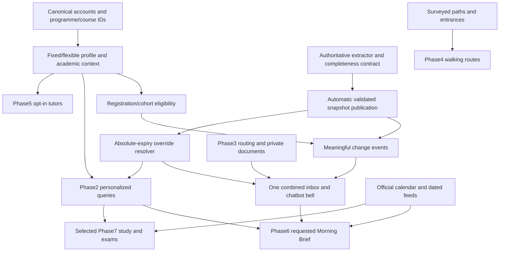

# Implementation dependencies

> **Phase2 local implementation — 2026-11-11:** [Implementation, exact source delta, fresh440/146 tests and limitations](17_PHASE_2_IMPLEMENTATION.md). Personalized StudentMode is implemented locally. Manual browser/visual acceptance is intentionally deferred until the consolidated seven-phase stage. Historical audit/Phase1 evidence below remains dated; no production release is implied.

> **Phase 1 implementation update (2026-11-10):** Read [the implementation delta, fresh tests and remaining acceptance gates](16_PHASE_1_IMPLEMENTATION.md) before using this historical audit snapshot. Fixed profile, automatic import adapter, persisted override and widget inbox are now implemented locally; no production release or browser acceptance is claimed.

Audit: **2026-11-10, Africa/Lusaka**. Local HEAD `9cbdeb0517da8820b94a623d9b8facbef50ae1ee`, branch `codex/production-integration`, **with pre-existing uncommitted unified-notification work**. Source findings describe that working tree unless explicitly marked production. Documentation only; no implementation/release authorized. [Master](00_MASTER_AUDIT.md) · [Evidence freshness](14_DECISIONS_AND_ASSUMPTIONS.md)

## Shared foundations once

| Order | Checkpoint | Dependency / parallelism |
|---|---|---|
|1|Account/curriculum identifiers,22/5/8 separation|New instruction; owner mapping and alias decisions|
|2|Shared context/fixed history|After1; simulation fixture policy|
|3|Auto import/targeting|Source contract collection can proceed alongside2; complete authoritative validation gates release|
|4|Effective override/one widget inbox|UI extraction can proceed locally; stable event/receipt/DB expiry semantics|
|5|Personalized mode|Context required; change answers also depend3/4; calendar truth or explicit unknown|
|6|Front desk routing/contact then attachments|Routing independent; privacy/retention gate for bytes|
|7|Campus routes|Survey independent; release blocked by physical verified geometry|
|8|Tutors|Canonical identity/catalogue and explicit opt-in/privacy|
|9|Morning Brief|Owned context/inbox/classes; trusted dated feeds only|
|10|Selected future features|Individual source/access gates|

Keep approved phase numbering. Safe source collection can happen independently; do not delay fixed identity/UI because campus survey is blocked. Do not release automatic removals without completeness evidence. Audit itself authorizes no implementation.

## Phase 3 implementation update — 2026-11-11

New004 is local only and depends on existing001–003. Contact seed file and existing private Storage credentials are server-only. No new service/dependency or production credential change is needed. See [Phase3 implementation and evidence](18_PHASE_3_IMPLEMENTATION.md) for authoritative current details. Earlier audit findings remain historical.

## Phase 5 local implementation — 2026-11-11

Local005 depends on preserved001–004. Existing academic records, signed identity, DB adapter and unified bell are reused; no paid service or new dependency. Production migrations remain separately gated. See [Phase5 implementation and fresh evidence](20_PHASE_5_IMPLEMENTATION.md). Older audit statements remain historical.

## Phase 6 local implementation — 2026-11-11

Local006 adds preferences, daily claims, reminders and due receipts; it depends on preserved001–005. Existing context, timetable and notification services are reused; no new paid service or key. See [Phase6 implementation and verification](21_PHASE_6_IMPLEMENTATION.md). Prior audit/proposal findings remain historical.

## Phase 7 local implementation — 2026-11-11

Local007 adds two publication/receipt metadata tables and depends on preserved001–006. Real data requires an authorized source publisher and review workflow. No new paid dependency/provider or separate vector system was added. See [implementation report](22_PHASE_7_IMPLEMENTATION.md) and [consolidated handoff](23_CONSOLIDATED_ACCEPTANCE_HANDOFF.md).
